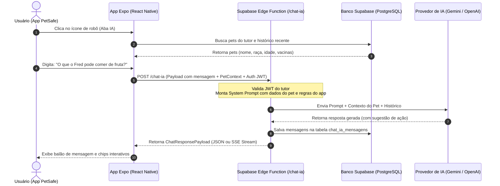

# 🤖 Feature: Assistente Virtual PetSafe (IA)

> **Documento de Especificação Técnica, DTOs e Payloads**  
> **Módulo:** Assistente Inteligente e Suporte Contextual  
> **Data:** 15 de Outubro de 2026  
> **Status:** Proposta de Arquitetura & Especificação

---

## 1. Visão Geral da Feature

O Assistente PetSafe é uma inteligência artificial conversacional integrada ao app, acessível diretamente pelo ícone de **robô** na barra de navegação inferior.

### Objetivos Principais:
1. **Guia e Suporte do App (Onboarding & Ajuda):** Ensinar o usuário a utilizar as funcionalidades do PetSafe (ativação de medalhas QR/NFC, cadastro de contatos de emergência, assinatura de planos, leitura de medalhas).
2. **Contexto dos Pets do Tutor:** Conhecer os pets do usuário (nomes, raças, idades, vacinas, histórico médico, observações de comportamento) para oferecer dicas personalizadas de saúde, nutrição e bem-estar.
3. **Ações Rápidas (Deep Links / Tool Calling):** Sugerir e direcionar o usuário para telas específicas do app (ex: *"Deseja abrir a carteira de vacinas do Thor agora?"*).
4. **Orientações de Emergência:** Aconselhar procedimentos iniciais de calma e busca caso o pet seja perdido ou precise de socorro emergencial.

---

## 2. Qual é a Melhor Arquitetura para Implementar?

### ⚠️ Regra de Ouro de Segurança:
**Nunca coloque a chave de API de IA (OpenAI, Google Gemini, Anthropic) diretamente no app cliente (React Native / Expo).** Qualquer chave compilada no app pode ser extraída via engenharia reversa.

### Arquitetura Recomendada:



### Principais Pilares da Solução:
1. **Frontend (Expo Router):**
   - Criação da rota `src/app/(tabs)/ia.tsx` (ou navegação via router `router.push('/ia')`).
   - Interface com mensagens em bolhas, scroll automático, estados de carregamento com *typing indicator* e chips de *Quick Prompts* (perguntas frequentes).
2. **Backend Seguro (Supabase Edge Function):**
   - Rota autenticada que valida o token do usuário (`supabase.auth.getUser()`).
   - Faz a injeção automática de contexto (*Context Injection*): busca os pets do usuário e injeta no `system prompt`.
3. **Persistência das Conversas:**
   - Tabelas no Supabase com Row Level Security (RLS) para que o histórico fique salvo entre sessões e acessível apenas pelo próprio tutor.

---

## 3. Modelo de Banco de Dados (Supabase / PostgreSQL)

```sql
-- 1. Sessão ou Tópico da Conversa com a IA
CREATE TABLE public.ia_conversas (
  id uuid NOT NULL DEFAULT gen_random_uuid(),
  usuario_id uuid NOT NULL,
  pet_id uuid REFERENCES public.pets(id) ON DELETE SET NULL, -- Opcional: pet focado
  titulo text NOT NULL DEFAULT 'Nova conversa',
  criado_em timestamp with time zone DEFAULT now(),
  atualizado_em timestamp with time zone DEFAULT now(),
  CONSTRAINT ia_conversas_pkey PRIMARY KEY (id),
  CONSTRAINT ia_conversas_usuario_id_fkey FOREIGN KEY (usuario_id) REFERENCES public.usuarios(id) ON DELETE CASCADE
);

-- RLS: Apenas o próprio usuário vê e cria suas conversas
ALTER TABLE public.ia_conversas ENABLE ROW LEVEL SECURITY;
CREATE POLICY "Usuário acessa suas próprias conversas"
  ON public.ia_conversas FOR ALL
  USING (auth.uid() = usuario_id);

-- 2. Mensagens da Conversa
CREATE TABLE public.ia_mensagens (
  id uuid NOT NULL DEFAULT gen_random_uuid(),
  conversa_id uuid NOT NULL,
  papel text NOT NULL CHECK (papel IN ('user', 'assistant', 'system')),
  conteudo text NOT NULL,
  metadata jsonb DEFAULT '{}'::jsonb, -- Ações, links, tokens gastos
  criado_em timestamp with time zone DEFAULT now(),
  CONSTRAINT ia_mensagens_pkey PRIMARY KEY (id),
  CONSTRAINT ia_mensagens_conversa_id_fkey FOREIGN KEY (conversa_id) REFERENCES public.ia_conversas(id) ON DELETE CASCADE
);

-- RLS: Apenas o dono da conversa acessa as mensagens
ALTER TABLE public.ia_mensagens ENABLE ROW LEVEL SECURITY;
CREATE POLICY "Usuário acessa mensagens de suas conversas"
  ON public.ia_mensagens FOR ALL
  USING (
    EXISTS (
      SELECT 1 FROM public.ia_conversas c 
      WHERE c.id = ia_mensagens.conversa_id AND c.usuario_id = auth.uid()
    )
  );
```

---

## 4. DTOs (Data Transfer Objects) em TypeScript

Crie um arquivo em `src/@types/ia.ts` ou `src/model/iaModel.ts` com as seguintes definições:

```typescript
// ==========================================
// 1. CONTEXTO DO USUÁRIO E DO PET
// ==========================================

export interface PetContextDTO {
  id: string;
  nome: string;
  especie: 'cachorro' | 'gato' | 'outro' | string;
  raca?: string;
  idadeAnos?: number;
  dataNascimento?: string;
  pesoKg?: number;
  medalhaAtiva: boolean;
  codigoMedalha?: string;
  vacinasPendentes?: string[];
  historicoRecente?: string[];
  observacoes?: string;
}

export interface UserContextDTO {
  usuarioId: string;
  nome: string;
  plano: 'gratuito' | 'basico' | 'premium' | 'familia';
  totalPets: number;
  pets: PetContextDTO[];
}

// ==========================================
// 2. MENSAGEM E HISTÓRICO
// ==========================================

export type MessageRole = 'user' | 'assistant' | 'system';

export interface ChatActionDTO {
  tipo: 'NAVIGATE' | 'OPEN_MODAL' | 'EXTERNAL_LINK';
  rotulo: string;
  rota?: '/pet/cadastrar' | '/(tabs)/perfil' | `/pet/${string}` | string;
  params?: Record<string, any>;
}

export interface ChatMessageDTO {
  id: string;
  conversaId: string;
  papel: MessageRole;
  conteudo: string;
  acoes?: ChatActionDTO[];
  criadoEm: string;
}

// ==========================================
// 3. REQUISIÇÃO (PAYLOAD DE ENVIO DO APP)
// ==========================================

export interface SendMessageRequestDTO {
  /** ID da conversa existente ou undefined/null para iniciar uma nova */
  conversaId?: string;
  
  /** Texto digitado pelo tutor */
  mensagem: string;

  /** ID do pet atualmente selecionado na tela de chat (se houver foco específico) */
  petFocoId?: string;

  /** Contexto opcional enviado pelo app para evitar buscas redundantes */
  contexto?: {
    telaAtual?: string;
    versaoApp?: string;
  };
}

// ==========================================
// 4. RESPOSTA DA IA (PAYLOAD DE RETORNO)
// ==========================================

export interface SendMessageResponseDTO {
  conversaId: string;
  mensagem: ChatMessageDTO;
  
  /** Sugestões de próximas perguntas para o usuário clicar (chips rápidos) */
  sugestoesProximasPerguntas?: string[];
  
  /** Metadados de uso */
  status: 'sucesso' | 'erro';
  erro?: string;
}

// ==========================================
// 5. CHIPS DE ATALHO (QUICK PROMPTS)
// ==========================================

export interface QuickPromptDTO {
  id: string;
  categoria: 'app' | 'pet' | 'emergencia';
  titulo: string;
  prompt: string;
  icone: string;
}
```

---

## 5. Exemplos de Payloads JSON Reais

### 5.1. Payload de Envio (Request: App ➔ Backend)

**Endpoint:** `POST https://<supabase-project-id>.supabase.co/functions/v1/chat-ia`  
**Headers:**
```http
Content-Type: application/json
Authorization: Bearer <SUPABASE_USER_ACCESS_TOKEN>
```

**Body:**
```json
{
  "conversaId": "d3b07384-d113-494a-9b48-18e38d7c2a11",
  "mensagem": "O que o Fred pode comer de frutas saudáveis no calor?",
  "petFocoId": "a81b6811-db53-4b36-9b58-e4b2a3d76e44",
  "contexto": {
    "telaAtual": "ia",
    "versaoApp": "1.0.0"
  }
}
```

---

### 5.2. Payload de Retorno (Response: Backend ➔ App)

```json
{
  "conversaId": "d3b07384-d113-494a-9b48-18e38d7c2a11",
  "mensagem": {
    "id": "e72c8491-fa24-4f51-b842-7a873d91cf33",
    "conversaId": "d3b07384-d113-494a-9b48-18e38d7c2a11",
    "papel": "assistant",
    "conteudo": "Como o **Fred** é um Golden Retriever de 2 anos, aqui estão ótimas frutas refrescantes que ele pode comer com moderação:\n\n1. **Melancia** (sem sementes e sem casca) - Excelente para hidratar!\n2. **Maçã** (sem sementes e sem o miolo) - Rica em fibras.\n3. **Banana** congelada em rodelas - Ótimo petisco gelado.\n\n⚠️ **Atenção:** Nunca ofereça uvas, passas ou carambola, pois são altamente tóxicas para cães.\n\nQuer que eu adicione um lembrete de alimentação na ficha do Fred?",
    "acoes": [
      {
        "tipo": "NAVIGATE",
        "rotulo": "Ver perfil do Fred",
        "rota": "/pet/a81b6811-db53-4b36-9b58-e4b2a3d76e44"
      }
    ],
    "criadoEm": "2026-10-15T14:30:00Z"
  },
  "sugestoesProximasPerguntas": [
    "Quais alimentos são proibidos para cães?",
    "Como saber se o Fred está desidratado?",
    "Como cadastrar uma nova vacina no app?"
  ],
  "status": "sucesso"
}
```

---

### 5.3. Exemplo de Pergunta sobre Uso do App

**Pergunta do Usuário:**  
`"Como faço para ativar a medalha do meu pet?"`

**Resposta da IA:**
```json
{
  "conversaId": "d3b07384-d113-494a-9b48-18e38d7c2a11",
  "mensagem": {
    "id": "f83a9921-2244-48cd-8a39-33b84dc92109",
    "conversaId": "d3b07384-d113-494a-9b48-18e38d7c2a11",
    "papel": "assistant",
    "conteudo": "Para ativar a medalha PetSafe do seu animalzinho, siga estes passos simples:\n\n1. Abra a câmera do seu celular ou o **Scanner de QR Code** na barra inferior do app;\n2. Aponte para o QR Code gravado na medalha PetSafe;\n3. Selecione qual dos seus pets cadastrados (ex: **Fred**) usará essa medalha;\n4. Confirme a ativação! A partir daí, se alguém escanear a medalha, você receberá a localização imediata dele por GPS.",
    "acoes": [
      {
        "tipo": "NAVIGATE",
        "rotulo": "Abrir Scanner de Medalha",
        "rota": "/(tabs)/index"
      }
    ],
    "criadoEm": "2026-10-15T14:32:00Z"
  },
  "sugestoesProximasPerguntas": [
    "O que acontece se alguém achar meu pet?",
    "Como cadastrar contatos de emergência?"
  ],
  "status": "sucesso"
}
```

---

## 6. System Prompt Recomendado para a IA

O backend deve montar o `system prompt` dinamicamente unindo o conhecimento do sistema aos dados do tutor:

```text
Você é o PetSafe AI, o assistente virtual especialista do aplicativo PetSafe.
Seu objetivo é ser amigável, acolhedor, conciso e prestativo com tutores de animais de estimação.

SEUS PAPÉIS:
1. Especialista no aplicativo PetSafe:
   - Explicar como cadastrar pets, ativar medalhas QR/NFC, ver leituras com localização GPS e gerenciar assinaturas.
   - Sempre que apropriado, indicar a tela correspondente no app.

2. Cuidados e Saúde com Pets:
   - Fornecer dicas seguras de cuidados diários, higiene, alimentação saudável e bem-estar.
   - SEMPRE alertar que suas respostas não substituem uma consulta com um médico veterinário licenciado em caso de sintomas ou emergências clínicas.

CONTEXTO DO USUÁRIO LOGADO:
- Nome do Tutor: {nome_tutor}
- Pets Cadastrados:
  * Pet 1: {nome: "Fred", especie: "cachorro", raca: "Golden Retriever", idade: "2 anos", vacinas_em_dia: true, medalha_ativa: true}
  * Pet 2: {nome: "Mimi", especie: "gato", raca: "Siamês", idade: "1 ano", vacinas_em_dia: false, medalha_ativa: false}

REGRAS DE RESPOSTA:
- Use formatação Markdown (negrito, listas com marcadores) para fácil leitura no celular.
- Mantenha respostas com no máximo 3 a 4 parágrafos curtos.
- Chame os pets pelo nome sempre que relevante para criar proximidade com o tutor.
```

---

## 7. Passos Práticos para Implementar no App

1. **Navegação (Expo Router):**
   - No rodapé de `src/app/(tabs)/index.tsx`, alterar o botão do robô:
     ```tsx
     <TouchableOpacity
       style={styles.itemRodape}
       onPress={() => router.push('/ia')}
     >
       <MaterialCommunityIcons name="robot" size={20} color="#FFA800" />
     </TouchableOpacity>
     ```
2. **Nova Tela do Chat:**
   - Criar `src/app/ia/index.tsx` (ou `src/app/(tabs)/ia.tsx`) com interface de chat moderna:
     - Header com avatar do PetSafe AI e nome do pet selecionado.
     - Carrossel horizontal de *Quick Prompts* no topo (ex: *"Dicas de alimentação"*, *"Como funciona a medalha"*, *"Vacinas"*).
     - `FlatList` invertida (`inverted`) para mensagens instantâneas.
     - Barra inferior de digitação com `TextInput` e botão de envio com vibração tátil (`expo-haptics`).
3. **Serviço de Comunicação (`src/services/iaService.ts`):**
   - Função `enviarMensagemParaIA(payload: SendMessageRequestDTO)` chamando o endpoint do Supabase.
   - Carregamento automático dos pets usando a função existente `listarMeusPets()` para compor o contexto inicial.
